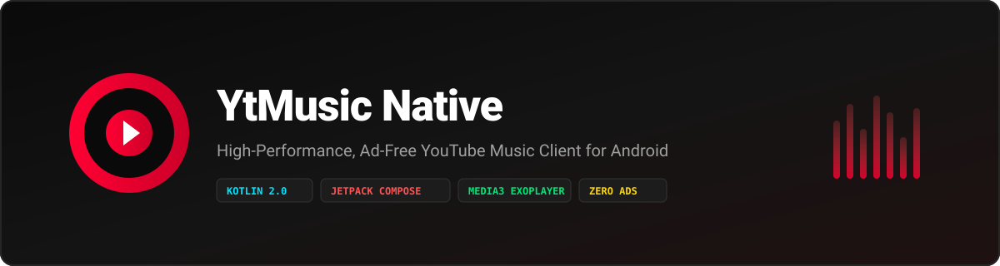

  
  
  
  
  
  
  

  <strong>Klien streaming YouTube Music native untuk Android. Ringan, cepat, hemat baterai, dan 100% bebas iklan komersial.</strong>

---

## Ringkasan Aplikasi

YtMusic Native adalah pemutar musik mandiri (*proprietary freeware*) yang dirancang khusus untuk memberikan pengalaman mendengarkan audio berkualitas tinggi tanpa interupsi iklan komersial dan tanpa pelacak analitik.

Aplikasi ini dikompilasi secara native untuk arsitektur Android Runtime (ART) dengan ukuran berkas hanya 3.2 MB dan konsumsi RAM yang sangat efisien (rata-rata di bawah 75 MB).

Repositori ini difungsikan secara eksklusif sebagai kanal distribusi rilis resmi (*compiled release binaries*) dan catatan pembaruan versi.

---

## Portal Resmi & Unduhan

| Kanal Distribusi | Tautan | Keterangan |
| :--- | :--- | :--- |
| **Website Resmi** | [ytmusic-blond.vercel.app](https://ytmusic-blond.vercel.app) | Landing page, dokumentasi fitur, dan direct download APK |
| **GitHub Releases** | [Releases Terbaru v1.1.4](https://github.com/yanzyuyu/YtMusicnative/releases/latest) | Unduhan paket biner APK `app-release.apk` |

---

## Fitur Utama

- **100% Bebas Iklan Komersial**: Pemutaran langsung dari sumber audio resmi tanpa gangguan iklan video atau pop-up sponsor.
- **Background Playback Murni**: Terintegrasi penuh dengan Android MediaSessionService; musik terus berputar saat layar HP dimatikan atau membuka aplikasi lain.
- **Visualizer Audio 120 FPS**: Animasi equalizer gelombang suara hardware-accelerated yang halus dan responsif.
- **Pencarian Cepat & Saran Otomatis**: Menampilkan rekomendasi artis dan judul lagu dengan transisi animasi pemuatan yang mulus.
- **Koleksi Playlist & Lagu Favorit**: Pengelolaan playlist kustom dengan tampilan kartu grid rasio 1:1 dan penyimpanan lokal instan.
- **Sinkronisasi Lirik Terintegrasi**: Penampil lirik otomatis dengan penanda baris vokal yang nyaman dibaca.
- **Pembaruan Otomatis Terintegrasi**: Pengecekan versi baru secara berkala di latar belakang dengan instalasi mandiri yang aman.

---

## Spesifikasi Teknis

| Parameter | Spesifikasi |
| :--- | :--- |
| **Target Platform** | Android 8.0 (API 26) hingga Android 15 |
| **Arsitektur Pemrograman** | 100% Kotlin 2.0 |
| **Antarmuka Pengguna** | Jetpack Compose Material 3 |
| **Mesin Audio** | AndroidX Media3 ExoPlayer 1.4.1 |
| **Format Audio** | High-Efficiency Opus / AAC |
| **Ukuran Berkas APK** | 3.2 MB |
| **Pelacak / Iklan** | 0 (Nol) |
| **Tipe Distribusi** | Freeware (Bebas Iklan) |

---

## Catatan Rilis Versi 1.1.4

- **Tab Detail Lagu**: Mengganti tab "Artis" pada pemutar musik menjadi tab "Detail Lagu" lengkap dengan ikon informasi baru, cover album membulat 16dp, kartu rincian audio, deskripsi artis, dan daftar lagu populer terkait.
- **Konsistensi Navigasi Gelap**: Memperbaiki masalah bilah navigasi 3 tombol sistem Android yang berubah menjadi putih pada sub-halaman. Seluruh bottom sheet kini terkunci dalam tema gelap pekat (`#0F0F0F`).
- **Penyempurnaan Area Layar (Punch-Hole)**: Penyesuaian safe area status bar agar judul dan teks tidak tertutup oleh kamera depan punch-hole.
- **Pengecekan Pembaruan Latar Belakang**: Layanan background checker berkala untuk memberitahukan ketersediaan rilis terbaru secara otomatis.

---

## Panduan Pemasangan

1. Unduh berkas `app-release.apk` dari [halaman rilis terbaru](https://github.com/yanzyuyu/YtMusicnative/releases/latest) atau [website resmi](https://ytmusic-blond.vercel.app).
2. Buka notifikasi unduhan pada perangkat Android Anda.
3. Jika muncul dialog perizinan keamanan, aktifkan opsi **Izinkan instalasi dari sumber ini**.
4. Tekan **Install** dan buka YtMusic Native untuk mulai menikmati streaming musik bebas gangguan.

---

  &copy; 2026 YtMusic Native. All rights reserved.

